# Keyboard layout

[QMK](https://docs.qmk.fm/) firmware for my ErgoDox EZ (the original model,
without RGB), Moonlander and Voyager, all built from one shared layout. This
directory is a [QMK external
userspace](https://docs.qmk.fm/newbs_external_userspace).

## ErgoDox EZ



## Moonlander



## Voyager



## Files

- `users/juliusz/layout.h`: **the layout**. The layers are written in the shape
  of the ErgoDox EZ, the biggest of the three keyboards. This is the file to
  edit. Keycodes: https://docs.qmk.fm/keycodes
- `users/juliusz/wrappers.h`: maps the ErgoDox-shaped layers onto the
  Moonlander and Voyager. See below for how.
- `users/juliusz/config.h`, `rules.mk`: settings shared by all keyboards.
- `keyboards/*/keymaps/juliusz/`: per-keyboard keymaps. They're mostly just
  `KEYMAPS(...)` with the right wrapper, plus keyboard-specific bits (e.g. the
  ErgoDox's layer LEDs and debounce setting).
- `keymap-drawer.yaml`: settings for the images.
- `images/`: generated by `make draw`. Commit them together with the layout
  change.

### How the layout maps to other keyboards

- **Moonlander**: same main block. The inner column has three 1u keys, so the
  ErgoDox's lower inner key (1.5u) moves up one row. The 3 big thumb keys are
  the ErgoDox's bottom row of the thumb cluster, and the red key gets the
  middle key of the cluster (Play/Pause on the left, Mute on the right). The
  top two keys of each thumb cluster (Prev/Next, Vol-/Vol+) are skipped.
- **Voyager**: only the outer 6 columns of the 4 main rows and the 2 big
  thumb keys on each side. The inner column, the bottom row and the rest of
  the thumb cluster are skipped, so on the base layer the Voyager loses LCtrl,
  LAlt/Esc, LGui/Esc, RAlt, RGui, `[`, `]`, Delete and the media keys, and
  F11/F12 on the SYMB layer.

If a key that only exists on the ErgoDox becomes important, move it to a
position that the smaller keyboards have too, e.g. a free key on the SYMB
layer.

## Commands

Run in this directory. The builds run in QMK's Docker image (Docker Desktop
needs to be running), unless a native `qmk` is on `PATH`, in which case
that's used.

```sh
make        # build firmware and draw images
make build  # build firmware only, into build/firmware/
make draw   # draw images only, into images/
make clean
```

The QMK source (qmk_firmware, ~1.3 GB) is cloned to `~/.cache/qmk_firmware`
when needed, at the version pinned by `QMK_VERSION` in the `Makefile`. It's
safe to delete. Set `QMK_FIRMWARE` to use a different location.

Drawing uses [keymap-drawer](https://github.com/caksoylar/keymap-drawer),
run with `uvx`.

### Flashing

Use [Keymapp](https://www.zsa.io/flash): choose the file from
`build/firmware/` (`ergodox_ez_base_juliusz.hex`,
`zsa_moonlander_juliusz.bin` or `zsa_voyager_juliusz.bin`), click Flash and
press the keyboard's reset button.

Alternatively, with a native QMK install (`brew trust qmk/qmk && brew install
qmk/qmk/qmk`), `qmk flash` can do it from the command line.

### Updating QMK

Bump `QMK_VERSION` (a [qmk_firmware
tag](https://github.com/qmk/qmk_firmware/tags)) and `QMK_IMAGE` in the
`Makefile`, and the container image in `.github/workflows/qmk.yml`. Then run
`make`. Check the [QMK changelog](https://docs.qmk.fm/ChangeLog/)
for breaking changes first.

## GitHub Actions

`.github/workflows/qmk.yml` runs `make build` and `make draw` on every push or
pull request that touches `qmk/`. The firmware and images are uploaded as
artifacts of the run (`firmware` and `images`). The run fails if the committed
images don't match the layout.

## Differences from the Oryx version

This layout was ported from Oryx ([original
layout](https://configure.zsa.io/ergodox-ez/layouts/qYArA/vpNNK/0)). Flashing
the firmware from Oryx brings the old setup back. Differences:

- Built from upstream QMK, not [ZSA's fork](https://github.com/zsa/qmk_firmware),
  so the Oryx-specific features (live training, Keymapp's live layer view) are
  gone.
- Keycodes were renamed to their current QMK names (e.g. `KC_BSPACE` →
  `KC_BSPC`), and `MT(MOD_LSFT, kc)` was written as `LSFT_T(kc)`.
- `IGNORE_MOD_TAP_INTERRUPT` was dropped: it was removed from QMK, and its
  behavior is now the default.
- Unused keys on the base layer are `XXXXXXX` instead of `_______`. They
  behave the same on the base layer.
